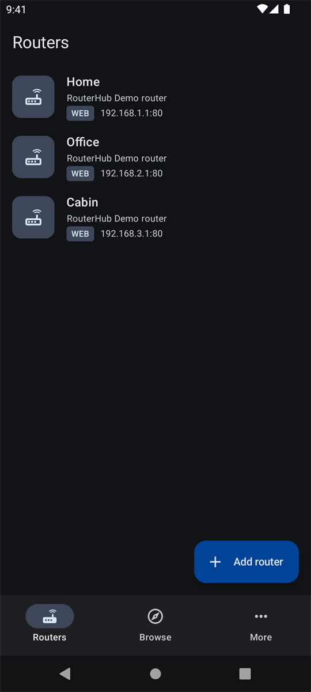
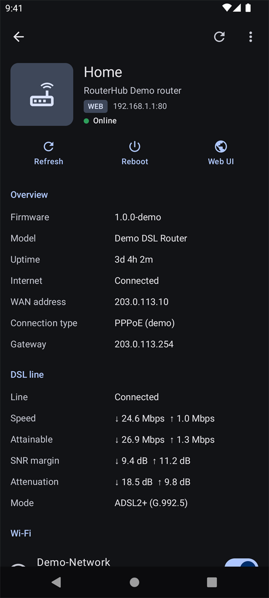
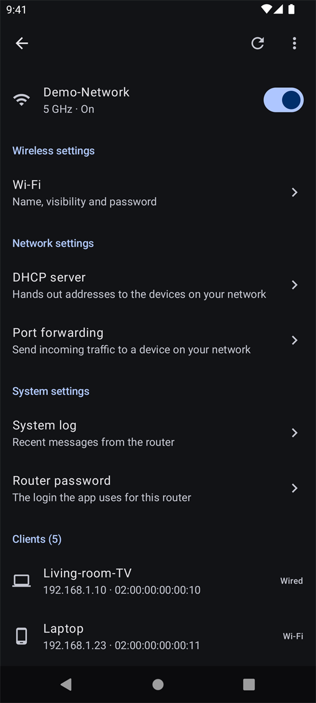
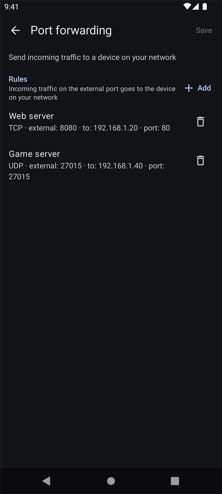
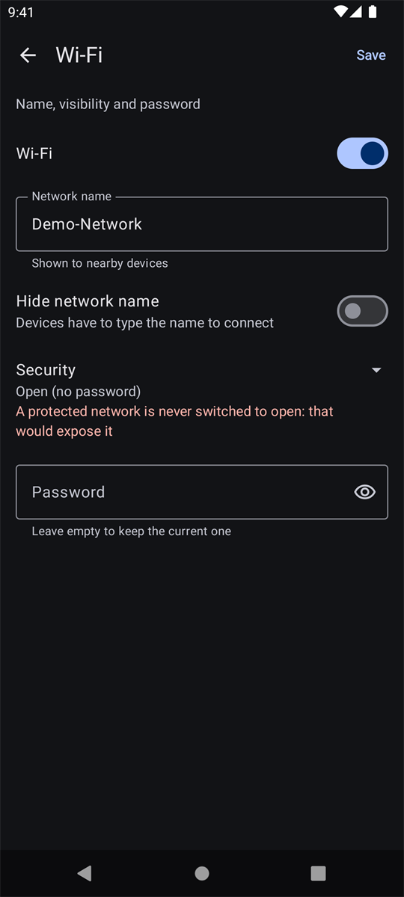
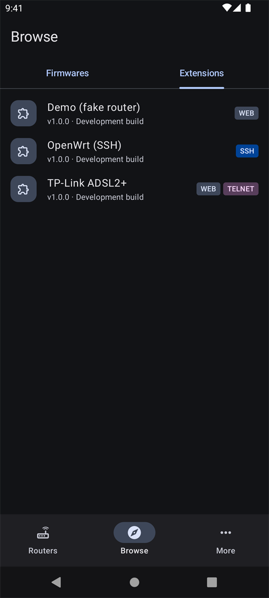
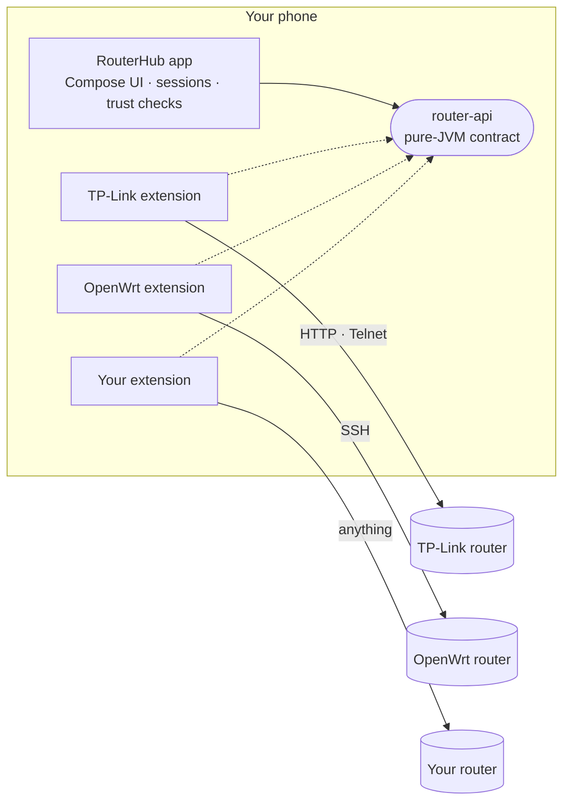

<p align="center">
  
</p>

<p align="center">
  <a href="https://github.com/atasanbratan/routerhub/actions/workflows/ci.yml"></a>
  <a href="LICENSE"></a>
  
  
  
  <a href="CONTRIBUTING.md"></a>
</p>

<p align="center">
  <b>An Android app with no router code in it.</b><br>
  Every router family is a small extension APK you install separately, the same idea as Mihon's sources.<br>
  One clean Material 3 app for every router you look after.
</p>

<p align="center">
  <a href="#why">Why</a> ·
  <a href="#screenshots">Screenshots</a> ·
  <a href="#how-it-works">How it works</a> ·
  <a href="#get-it-running">Get it running</a> ·
  <a href="#supported-routers">Supported routers</a> ·
  <a href="#write-an-extension">Write an extension</a> ·
  <a href="#contributing">Contributing</a>
</p>

---

## Why

Router admin pages are slow, built for a desktop browser, and different for every vendor. Apps that
fix that usually fix it for one vendor.

RouterHub splits the problem in three:

- **The app** knows how to look good, store credentials safely, and render *any* router's settings
  from a plain description. It knows nothing about any specific router.
- **`router-api`** is a tiny pure-JVM contract between the two.
- **Extensions** are headless APKs that teach the app one router family. They are loaded into the app
  at runtime, after their signature has been checked.

So supporting your router means writing one small extension, not forking an app. And you can try
everything today **without owning a compatible router**: the Demo extension is a fake router that
lives in memory.

## Screenshots

<table>
  <tr>
    <td align="center"><br><sub><b>Your routers</b></sub></td>
    <td align="center"><br><sub><b>Live overview</b></sub></td>
    <td align="center"><br><sub><b>Settings and clients</b></sub></td>
    <td align="center"><br><sub><b>Forms from a description</b></sub></td>
  </tr>
  <tr>
    <td align="center"><br><sub><b>Editable lists</b></sub></td>
    <td align="center"><br><sub><b>Safeguards that explain</b></sub></td>
    <td align="center"><br><sub><b>Extensions you control</b></sub></td>
    <td></td>
  </tr>
</table>

<sub>Shown with the Demo extension, so every address and name above is made up.</sub>

## What you get

| | |
|---|---|
| **Overview** | Model, firmware, uptime, WAN state and address, DSL line quality, Wi-Fi radios with a quick switch, and the devices on your network. Reboot, or jump to the router's own web page. |
| **Settings pages** | The extension describes each page as typed fields: switches, text, passwords, numbers, choices and editable lists. The app renders them as a form and sends back **only what you changed**. |
| **Safeguards** | Extensions can refuse dangerous changes before anything is sent, and the app shows the reason right under the field. A save is never silently replayed, so a flaky link cannot apply a change twice. |
| **Three protocols** | `WEB` (HTTP admin pages), `SSH` (host keys pinned on first use) and `TELNET` for old routers that have nothing better. One extension can offer the same router over several. |
| **Looks like a modern app** | Material 3, dynamic colour, light, dark and pure-black themes. |
| **Safe by design** | Router passwords are encrypted on the device. Extensions are signature-checked before their code runs, and unknown signers stay unloaded until you trust them. |

## How it works



An extension is an Android APK with no activities and no permissions. The app finds it by a manifest
tag, checks that its signer is trusted, and only then loads its class into the app's own process:

```
installed packages
  └─ has <uses-feature dev.routerhub.extension>?        discovery
       └─ declares an API version this app supports?     compatibility
            └─ is its signer official, development or trusted by you?   signature check
                 └─ load the entry class and read its firmware factories
```

Nothing from an extension runs before both checks have passed. The details, including the class loader
rules that make loading code across APKs work, are in [docs/architecture.md](docs/architecture.md).

## Get it running

**Just want the app?** Download the signed APK from [GitHub Releases](https://github.com/atasanbratan/routerhub/releases/latest)
or the [website](https://atasanbratan.github.io/routerhub/download), then pick extensions from the
[extension list](https://atasanbratan.github.io/routerhub/extensions/). The rest of this section builds it from source.

You need JDK 17+, the Android SDK (API 36) and an Android 9+ device or emulator.

```bash
git clone https://github.com/atasanbratan/routerhub.git
cd routerhub
./gradlew :app:assembleGithubDebug
adb install -r app/build/outputs/apk/github/debug/app-github-debug.apk
```

The app is an empty shell until an extension is installed. Build the ones you want from the
[extensions repository](https://github.com/atasanbratan/routerhub-extensions) and install them the same way:

```bash
git clone https://github.com/atasanbratan/routerhub-extensions.git
cd routerhub-extensions
./gradlew assembleDebug
adb install -r extensions/demo/build/outputs/apk/debug/demo-debug.apk
```

Then open **Browse → Extensions**. Extensions signed with the same debug key as your app are shown as
*Development build* and load straight away; anything else shows a **Trust** button.
Add a router from the **Routers** tab and pick its firmware, or pick *Demo router*, type any address
and password, and look around. (The password `wrong` shows the wrong-credentials flow.)

Every push builds and tests the app on GitHub Actions, and the debug APK is attached to each run.

## Supported routers

| Extension | Protocols | Highlights | Status |
|---|---|---|---|
| **TP-Link ADSL2+** (TD-W8960N) | Web, Telnet | Status, DSL stats, clients, reboot, and 21 settings pages: Wi-Fi, guest network, MAC and website filters, port forwarding, DHCP, DDNS, UPnP, SNMP and more | Verified on real hardware |
| **OpenWrt** | SSH | Status, clients, Wi-Fi switch, reboot | Unit-tested only, hardware reports welcome |
| **Demo** | none (in memory) | Every field type, plus a deliberate failure to see the error handling | For trying the app and as a template |

All of them live in [routerhub-extensions](https://github.com/atasanbratan/routerhub-extensions).
Don't see your router? That is the best first contribution.

## Write an extension

An extension is a manifest, one entry class, and a firmware implementation. The shape of it:

```kotlin
class AcmeExtension : RouterExtension {
    override val factories = listOf(AcmeFactory())
}

internal class AcmeFactory : RouterFirmwareFactory {
    override val id = "acme.ax1800"              // permanent: saved routers refer to it
    override val displayName = "AX1800"
    override val vendor = "Acme"
    override val protocol = Protocol.WEB
    override val capabilities = setOf(Capability.STATUS, Capability.REBOOT)

    override fun create(config: ConnectionConfig): RouterFirmware =
        AcmeFirmware(config as ConnectionConfig.Web, capabilities)
}

internal class AcmeFirmware(
    private val config: ConnectionConfig.Web,
    override val capabilities: Set<Capability>,
) : RouterFirmware {
    override suspend fun login() { /* sign in, or throw WrongCredentialsException */ }
    override suspend fun getStatus() = RouterStatus(model = "AX1800", uptimeSeconds = 86_400)
    override suspend fun reboot() { /* ... */ }
    override suspend fun close() { /* ... */ }
}
```

Declare only the capabilities you implement and the app only offers those controls. Add settings pages
and the app renders them with no UI work from you. The full guide, with the manifest, the build setup
and the testing approach we use, is [docs/writing-an-extension.md](docs/writing-an-extension.md), and the
[Demo extension](https://github.com/atasanbratan/routerhub-extensions/tree/main/extensions/demo) is a
working starting point you can copy.

## Security

Extensions run inside the app's process with the app's permissions, so trusting an extension means
trusting its code. RouterHub makes that choice explicit: signatures are verified before loading, unknown
signers wait for your approval (bound to package, version and signer, so every update asks again), SSH host
keys are pinned on first use, and credentials are redacted from every `toString()`. Report a
vulnerability privately through [SECURITY.md](SECURITY.md).

## Roadmap

- [x] Signed releases ([how releasing works](docs/releasing.md)) and a website with the extension list
- [ ] An in-app extension index, so installing one is a tap
- [ ] More pages for the TP-Link extension: QoS, IPTV, ALG, DNS, backup and restore
- [ ] A Wi-Fi schedule grid editor, and advanced radio settings (needs careful hardware testing)
- [ ] Translations: the app's strings are English-only today
- [ ] Instrumented UI tests
- [ ] More routers. Yours?

Have an idea? Open a [discussion](https://github.com/atasanbratan/routerhub/discussions) or an issue.

## Contributing

Contributions of every size are welcome: code, a new extension, a test on hardware you own, docs,
translations, or just a good bug report. Start with [CONTRIBUTING.md](CONTRIBUTING.md), and look for the
[`good first issue`](https://github.com/atasanbratan/routerhub/labels/good%20first%20issue) label. Please
follow our [Code of Conduct](CODE_OF_CONDUCT.md).

## Acknowledgements

RouterHub borrows the extension idea from [Mihon](https://github.com/mihonapp/mihon) and Tachiyomi. It
is an independent project and is not affiliated with them. The router icon is a Material icon (Apache
2.0). Vendor and product names, such as TP-Link and OpenWrt, belong to their owners and appear only to
say what an extension works with.

## License

[Apache License 2.0](LICENSE). Extensions that you write against `router-api` can use any license you like.
